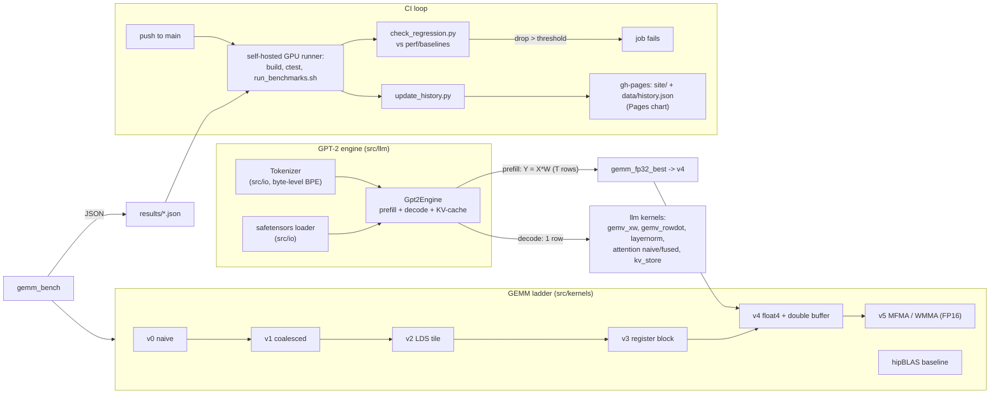
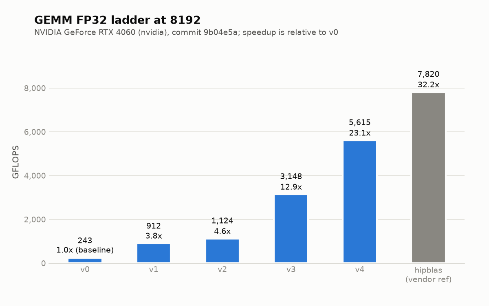

# hip-gpt2

A ladder of six hand-written HIP matrix-multiply (GEMM) kernels, from a naive baseline (v0) to matrix-core instructions (v5), each benchmarked against the vendor library (hipBLAS). The kernels feed a small GPT-2 inference engine written in C++/HIP, with no PyTorch at inference time, and a performance CI loop tracks every commit.

> **Measured on an NVIDIA RTX 4060** (HIP on CUDA, Windows 11 + WSL2/Docker). Every number below comes from a file in [`results/`](results/). AMD Instinct MI300X results are pending. See [Status](#status--whats-verified) for what is verified and what is not. Write-up with interactive charts: https://adithomas.github.io/hip-gpt2/

## Architecture



In words: the tokenizer and weight loader are plain C++ (no GPU). The engine runs GPT-2 on the GPU with two code paths. Prefill (the whole prompt at once) is a real matrix multiply and uses the GEMM ladder's best FP32 stage (`gemm_fp32_best`, which is v4). Decode (one token at a time) is memory-bound, so it uses simple matrix-vector kernels instead.

## Results

Device: `NVIDIA GeForce RTX 4060` (8 GB, HIP 6.4.3 on CUDA 12.6, WSL2/Docker), commit `9b04e5a`, date `2026-11-18`. Medians of 100 timed launches; run-to-run spread for v4 at 4096 is about 3%. AMD MI300X: pending.

### GEMM, FP32 (GFLOPS, square matrices, higher is better)

| Kernel | 1024 | 2048 | 4096 | 8192 |
|---|---|---|---|---|
| v0 naive | `244` | `242` | `244` | `243` |
| v1 coalesced | `1,012` | `1,012` | `905` | `912` |
| v2 LDS tiled | `1,292` | `1,291` | `1,142` | `1,124` |
| v3 register blocked | `3,267` | `3,358` | `3,162` | `3,148` |
| v4 float4 + double buffer | `6,700` | `5,787` | `5,839` | `5,615` |
| hipBLAS (`hipblas`) | `6,809` | `8,188` | `8,032` | `7,820` |

### GEMM, FP16 inputs with FP32 output (GFLOPS)

| Kernel | 1024 | 2048 | 4096 | 8192 |
|---|---|---|---|---|
| v0_fp16 | `238` | `237` | `235` | `238` |
| v4_fp16 | `4,995` | `4,788` | `4,591` | `4,602` |
| v5 (MFMA / WMMA) | `23,046` | `21,789` | `14,821` | `12,382` |
| hipBLAS (`hipblas_fp16`) | `36,158` | `44,035` | `42,609` | `48,023` |

`hipblas_fp16` produces FP16 output (and may accumulate in FP16), so it is a speed reference, not an accuracy-equal comparison.

### The ladder at a glance



(Generate it with `python3 scripts/plot_results.py --results results --out /tmp/plots`, then copy `/tmp/plots/gemm_ladder_fp32.png` to `docs/img/ladder_fp32.png`. If results for more than one device are present, the file name gets a device suffix.)

### GPT-2 small (124M parameters, FP32), prompt `scripts/bench_prompt.txt`, 128 new tokens, greedy

| Engine | Device | TTFT (ms) | Decode (tokens/s) |
|---|---|---|---|
| hip-gpt2 (fused attention, `v4` GEMM) | `NVIDIA GeForce RTX 4060` | `6.8` | `295` |
| hip-gpt2 (naive attention) | `NVIDIA GeForce RTX 4060` | `6.6` | `276` |
| PyTorch (`tools/torch_generation_baseline.py`) | `NVIDIA GeForce RTX 4060` | `11.9` | `83` |

Correctness vs the PyTorch reference on real GPT-2 weights: max abs logit error `3.2e-04` (target <= 1e-2), greedy tokens identical for 32 steps: `yes (32/32)`.

TTFT = time to first token (prefill plus sampling, measured on the host). Decode tokens/s = (generated tokens - 1) / wall time of the decode loop. Both are measured the same way in the C++ engine and the PyTorch script.

## Quick start

You need CMake 3.28 or newer for the GPU builds. A step-by-step beginner guide is in [docs/SETUP.md](docs/SETUP.md).

### Try GPT-2 on an NVIDIA GPU from Windows

With Docker Desktop installed: `.\scripts\gpt2.ps1 "Once upon a time"` (or `-Chat` for a prompt loop). Details in [docs/SETUP.md](docs/SETUP.md#a0-windows--nvidia-gpu-via-docker-no-linux-install).

### CPU (HIP-CPU, no GPU needed)

Used for correctness checks and CI. Needs `cmake g++ libtbb-dev` and a HIP-CPU checkout.

```bash
git clone https://github.com/ROCm/HIP-CPU ~/deps/HIP-CPU
cmake -S . -B build -DGEMM_BACKEND=cpu -DHIP_CPU_DIR=$HOME/deps/HIP-CPU && cmake --build build -j
ctest --test-dir build --output-on-failure
```

On the CPU backend, `v5`, `hipblas` and `hipblas_fp16` are listed as unavailable (no matrix cores, no hipBLAS). Timings from this backend are not GPU numbers.

### NVIDIA (RTX 4060, via HIP on CUDA)

```bash
cmake -S . -B build-nv -DCMAKE_HIP_PLATFORM=nvidia -DCMAKE_HIP_ARCHITECTURES=89 && cmake --build build-nv -j && ctest --test-dir build-nv --output-on-failure && ./build-nv/gemm_bench --kernel v5 --test && ./build-nv/gemm_bench --kernel all --out results
```

`v5` uses `nvcuda::wmma` (tensor cores) on this platform.

### AMD (Instinct MI300X, gfx942)

```bash
cmake -S . -B build-amd -DCMAKE_HIP_ARCHITECTURES=gfx942 -DCMAKE_PREFIX_PATH=/opt/rocm && cmake --build build-amd -j && ctest --test-dir build-amd --output-on-failure && ./build-amd/gemm_bench --kernel v5 --test && ./build-amd/gemm_bench --kernel all --out results
```

`v5` uses MFMA instructions here. For a Radeon RX 7900 (RDNA3, experimental): `-DCMAKE_HIP_ARCHITECTURES=gfx1100 -DHIPGPT2_ENABLE_RDNA3_WMMA=ON`.

## How to run things

Replace `<b>` with your build directory (`build`, `build-nv`, `build-amd`).

| Task | Command |
|---|---|
| All tests | `ctest --test-dir <b> --output-on-failure` |
| List kernels and availability | `./<b>/gemm_bench --list` |
| Correctness of one kernel on awkward shapes | `./<b>/gemm_bench --kernel v4 --test` |
| Benchmark everything (default sweep: 512..8192 on GPU) | `./<b>/gemm_bench --kernel all --out results` |
| Benchmark chosen sizes | `./<b>/gemm_bench --kernel all --sizes 1024,2048,4096,8192 --out results` |
| Non-square shape | `./<b>/gemm_bench --kernel v4 --sizes 4096x1024x512` |
| Plot | `python3 scripts/plot_results.py --results results --out /tmp/plots` |
| Profile on AMD (rocprof-compute) | `BUILD_DIR=<b> scripts/profile_amd.sh v4 4096` |
| Profile on NVIDIA (Nsight Compute) | `BUILD_DIR=<b> scripts/profile_nvidia.sh v4 4096` |
| Tiny-model engine smoke run (no download) | `./<b>/gpt2 --model tests/data/tiny --tokens 5,17,42 --max-new-tokens 8` |
| Real GPT-2, generate text | `./<b>/gpt2 --model models/gpt2 --prompt "The capital of France is" --max-new-tokens 32` |
| Real GPT-2, benchmark numbers | `./<b>/gpt2 --model models/gpt2 --prompt-file scripts/bench_prompt.txt --max-new-tokens 128 --warmup 1 --bench-out results` |
| PyTorch baseline | `python3 tools/torch_generation_baseline.py --model models/gpt2 --prompt-file scripts/bench_prompt.txt --max-new-tokens 128 --out results` |

Getting the real GPT-2 weights and checking them against PyTorch (needs `pip install -r tools/requirements.txt`):

```bash
python3 tools/export_reference_logits.py --out models/gpt2 --prompt "The capital of France is" --ref /tmp/ref_all.bin
./<b>/gpt2 --model models/gpt2 --prompt "The capital of France is" --dump-logits /tmp/cpp_all.bin --dump-mode all
python3 tools/compare_logits.py /tmp/ref_all.bin /tmp/cpp_all.bin --tol 1e-2
```

`gpt2` prints a stats block (`prompt_tokens`, `gen_tokens`, `load_ms`, `ttft_ms`, `decode_tok_per_s`). Useful flags: `--attn naive|fused` (decode attention kernel), `--no-kv-cache` (slow debug baseline), `--warmup N`, `--temperature F --top-k K --seed S`, `--quiet`.

## Repo layout

```
CMakeLists.txt        build options (GEMM_BACKEND, HIPGPT2_* switches)
include/              shared headers: gemm.hpp, hip_common.hpp, reference.hpp, tokenizer.hpp, ...
src/kernels/          the GEMM ladder: v0..v5, FP16 variants, hipBLAS baseline, registry.hip
src/bench.hip         gemm_bench: correctness (--test) and benchmark harness, writes JSON
src/reference.cpp     CPU reference used to check every kernel
src/io/               tokenizer, safetensors loader, config reader (plain C++)
src/llm/              GPT-2 engine, sampler, CLI (main.hip), kernels/ (layernorm, attention, gemv, ...)
tests/                unit and end-to-end tests; tests/data/tiny is a small random GPT-2 with reference outputs
tools/                Python helpers: reference logits, PyTorch baseline, tiny-model generator, tokenizer fixtures
scripts/              regression check, history, plotting, profiling wrappers, exercise generator
site/                 Pages site: write-up (index.html), perf history (perf.html + chart.js), data/
perf/baselines/       committed baseline JSON per device (created by --update-baseline)
assets/gpt2/          GPT-2 vocabulary files (encoder.json, vocab.bpe) + MIT license
exercises/            the same source tree with kernel bodies blanked (see below)
docs/                 SETUP.md, stages/, BLOG.md, DEMO_VIDEO_SCRIPT.md
.github/workflows/    ci.yml, bench.yml
```

Design notes: [docs/PROJECT_EXPLAINED.md](docs/PROJECT_EXPLAINED.md) and [docs/STUDY_GUIDE.md](docs/STUDY_GUIDE.md) (written separately). Per-stage write-ups: [v0](docs/stages/v0.md), [v1](docs/stages/v1.md), [v2](docs/stages/v2.md), [v3](docs/stages/v3.md), [v4](docs/stages/v4.md), [v5](docs/stages/v5.md), [LLM kernels](docs/stages/llm.md).

## Teaching layout: solutions and exercises

`src/` holds the complete solutions. Every kernel file starts with four comment lines (`STAGE`, `CHANGES`, `WHY FASTER`, `PREDICTED BOTTLENECK`), and inside each `__global__` function and `launch_*` function the body sits between `// BEGIN SOLUTION` and `// END SOLUTION`. Constants and helper declarations stay outside the markers.

`scripts/make_exercises.py` copies the tree and replaces everything between the markers with `// TODO: your code here`:

```bash
python3 scripts/make_exercises.py --src src --out exercises
```

The result in `exercises/` (checked in, currently identical to a fresh run) has the file headers, the tile constants and the function signatures, but not the bodies. It is a copy of `src/` only: CMake builds `src/`, not `exercises/`, so to attempt an exercise you copy a blanked file over its twin in a scratch checkout and rebuild. `tests/` and `include/` are not duplicated.

## CI

Two workflows in `.github/workflows/`:

- **`ci.yml`** (every push and pull request). Job `cpu-tests` on a hosted Ubuntu 24.04 runner: installs the tools, fetches HIP-CPU at a pinned commit, builds with `-DGEMM_BACKEND=cpu`, runs all of ctest, then the script self-tests. Job `rocm-compile` (informational, `continue-on-error`): builds inside a `rocm/dev-ubuntu-24.04` container for `gfx942`, so the MFMA code at least compiles. It does not run anything. The container tag must be confirmed on Docker Hub before you rely on it.
- **`bench.yml`** (push to `main` and manual dispatch) on a self-hosted runner labelled `self-hosted, gpu`. It builds with the flags in the repository variable `HIP_CMAKE_FLAGS`, runs ctest, runs `scripts/run_benchmarks.sh` (GEMM at sizes 1024, 2048, 4096; the GPT-2 benchmark only if `GPT2_MODEL_DIR` is set), then compares against `perf/baselines` with `check_regression.py`. A kernel that is more than `PERF_THRESHOLD_PCT` percent slower (default 7) fails the job; so does any result with `verified: false`. The history is appended and published to the `gh-pages` branch (a Pages chart of GFLOPS, TTFT and tokens/s per commit) even when the check fails, and `results/` is uploaded as an artifact.

Setup details: [docs/SETUP.md](docs/SETUP.md#d-github-repo-self-hosted-runner-and-pages).

## Status / what's verified

**Verified on CPU (HIP-CPU), by the test suite:**
- All FP32 kernels v0..v4, `v0_fp16` and `v4_fp16` against the CPU reference on awkward shapes (1x1x1 up to 333x257x129), including the aligned and misaligned `float4` paths.
- Tokenizer ids equal OpenAI's `encoder.py` on every case in `tests/data/tokenizer_cases.txt`.
- safetensors loader and config reader.
- Every LLM kernel against a plain C++ reference; naive and fused attention agree.
- Tiny random GPT-2: logits match a float64 numpy implementation (max abs error <= 1e-3), greedy tokens identical, prefill and token-by-token decode agree.
- The regression script and the exercise generator (self-tests).
- `v5` MFMA lane layout (MI300X path): checked by hand, compiled device-only for gfx942 with clang (emits `v_mfma_f32_16x16x16_f16`), and emulated on the CPU through the real staging/store code (CTest `v5_mfma_emulation`). See [docs/REVIEW.md](docs/REVIEW.md).

**Verified on an NVIDIA RTX 4060 (2026-11-17/18, HIP 6.4.3 on CUDA 12.6, Docker on WSL2):**
- Builds with 0 errors and 0 warnings; `ctest` 9/9.
- All 10 kernels, including `v5` via `nvcuda::wmma` and both hipBLAS baselines, pass `gemm_bench --test` on 12 shapes up to 2049x1023x515 (v5 max error 4.4e-7).
- Every number in [Results](#results), from `results/*.json`.
- Real GPT-2 weights against PyTorch: max abs logit error 3.2e-4 over the prompt (tolerance 1e-2), and greedy tokens identical for 32 steps (`results/h3_NVIDIA_GeForce_RTX_4060.json`). This found and fixed one bug: `tools/export_reference_logits.py` was dropping the `c_attn.bias` weights.
- The `rocm-compile` CI container tag (`rocm/dev-ubuntu-24.04:6.4.1`) exists.

**Not yet verified:**
- `v5` MFMA on AMD Instinct (MI300X) and RDNA3 WMMA: compiled device-only and MFMA emulated on CPU (reviewer confidence ~90%); still needs a real AMD GPU.
- Profiler counters (`scripts/profile_*.sh`): not yet collected, so the "WHY FASTER" comments in the kernels are still hypotheses.
- The self-hosted runner and the benchmark CI job.
- On the 4060, fused decode attention is no faster than the naive version at this prompt length (296 vs 281 tokens/s averaged over 3 runs, with the ranges overlapping).

## License

The GPT-2 vocabulary files in `assets/gpt2/` (`encoder.json`, `vocab.bpe`) come from OpenAI's gpt-2 repository, released under a Modified MIT License; its text is in `assets/gpt2/LICENSE`. `tools/third_party/encoder.py` is an unmodified copy from the same repo. The rest of this repository is under the MIT License; see [LICENSE](LICENSE).
