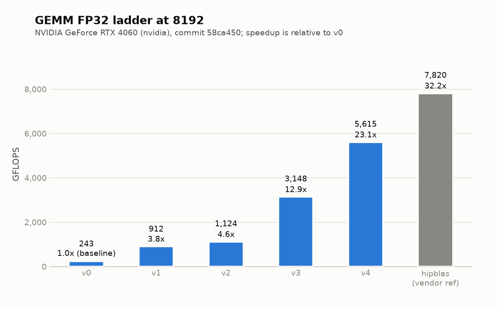
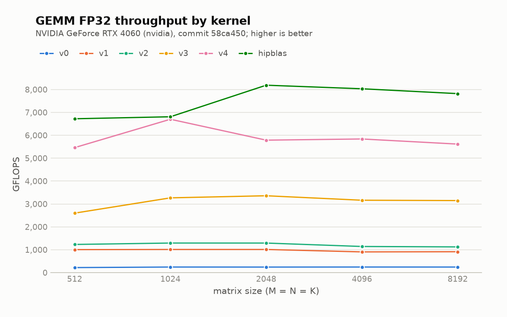
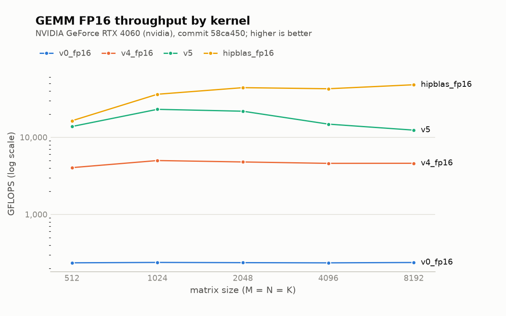

# Hand-writing GPU matrix multiply in HIP, then running GPT-2 on it

*Aditya Thomas · November 2026 · Part 1: measured on an NVIDIA RTX 4060. Part 2 adds AMD Instinct MI300X.*

> The published version, with interactive charts: https://adithomas.github.io/hip-gpt2/
> Every number here comes from [`results/`](../results/). Re-run `scripts/fill_placeholders.py` and `scripts/build_site_data.py` after new benchmarks.

Six matrix-multiply kernels, from a naive loop to tensor-core instructions, each measured against the vendor library. Then a GPT-2 inference engine in C++/HIP built on them, with no PyTorch at inference time.

| | |
|---|---|
| Best hand-written FP32 kernel (v4) | **5,839 GFLOP/s**, 73% of hipBLAS at N = 4096 |
| Tensor-core FP16 kernel (v5) | **14.8 TFLOP/s** at 4096, 3.2× the scalar FP16 kernel |
| GPT-2 small decode | **295 tokens/s**, 3.5× PyTorch eager (83) |
| Matches PyTorch | max logit error **3.2e-4**, 32/32 greedy tokens identical |

Device: RTX 4060 8 GB, HIP 6.4.3 on CUDA 12.6, Windows 11 + WSL2/Docker.

## The problem

A matrix multiply `C = A × B` of two N × N matrices costs `2N³` floating-point operations: 137 billion for N = 4096. Almost everything in a transformer is one. A GPU can do arithmetic far faster than it can fetch numbers from its memory, so the whole game is how many times each number gets used once it's on the chip.

The yardstick is hipBLAS, the vendor library (on NVIDIA it calls cuBLAS). Every kernel is first checked against a double-precision CPU reference on awkward shapes (1×1×1, primes, sizes that don't divide the tile). Only then is it timed: the median of 100 launches.

## Climbing the ladder

Each stage changes one idea. The numbers are measured at N = 4096. **Hypothesis** marks claims I haven't yet confirmed with profiler counters.

| Stage | What changed | GFLOP/s | vs previous |
|---|---|---|---|
| v0 | One thread per output, straight from memory. Neighbouring threads read far-apart addresses. | 244 | (3% of hipBLAS) |
| v1 | Coalescing: neighbouring threads read neighbouring addresses. | 905 | 3.7× |
| v2 | 32 × 32 shared-memory (LDS) tiles, each value reused 32 times. | 1,142 | 1.3× |
| v3 | Register blocking: each thread computes a 4 × 4 patch. | 3,162 | 2.8× |
| v4 | `float4` loads when aligned, plus double buffering. | 5,839 | 1.8× |
| hipBLAS | Vendor library | 8,032 | |

v2's gain is much smaller than its cut in memory traffic suggests. **Hypothesis:** the 4060's caches were already catching much of v1's reuse, and v2 now pays two LDS reads per multiply-add. Overall it's 23.9× from v0 to v4. v4 reaches 73% of hipBLAS at 4096 and 98% at 1024, but only about 39% of the card's 15.1 TFLOPS FP32 datasheet peak.

## v5: tensor cores

Modern GPUs have matrix units that do a whole 16 × 16 × 16 block of multiply-adds in one instruction: MFMA on AMD Instinct, WMMA on RDNA3, and tensor cores (`nvcuda::wmma`) on NVIDIA. v5 keeps v4's FP16 data movement exactly and swaps only the inner product. On the 4060 the `nvcuda::wmma` path compiled and passed every correctness shape on the first try.

It reaches 23.0 TFLOP/s at N = 1024 (4.6× the scalar FP16 kernel) but falls to 12.4 at 8192, while hipBLAS keeps climbing. **Hypothesis:** the drop starts roughly where the matrices outgrow the card's 24 MB L2 cache. From there, v5's 64 × 64 tiles and strided B-fragment reads from LDS can't hide main-memory latency. Nsight Compute is the next check. hipBLAS FP16 writes FP16 output and may accumulate in FP16, so it's a speed reference, not a like-for-like comparison.

## From kernels to a language model

GPT-2 small (124M parameters, 12 layers) is small enough to read in an afternoon and real enough to expose everything that matters. The engine is C++/HIP: a byte-level BPE tokenizer written from scratch (checked token for token against OpenAI's), a safetensors loader, kernels for embedding, layer norm, GELU, attention and the LM head, and a KV-cache.

- **Prefill** processes the whole prompt at once, so the linear layers are real matrix multiplies and use the v4 kernel. 86 prompt tokens take 6.6 ms.
- **Decode** makes one token at a time. Every weight is read once per token, so the limit is streaming ~500 MB of weights per token. At 272 GB/s (datasheet), that caps decode at about 544 tokens/s.

| Engine (128 greedy tokens, 86-token prompt) | Decode tokens/s | TTFT ms |
|---|---|---|
| hip-gpt2, fused attention | 295 | 6.8 |
| hip-gpt2, naive attention | 276 | 6.6 |
| hip-gpt2, no KV-cache | 105 | 6.7 |
| PyTorch eager (Hugging Face GPT-2, FP32, KV cache) | 83 | 11.9 |

The engine decodes at 54% of the bandwidth ceiling, 3.5× plain PyTorch eager mode on the same GPU. PyTorch here pays Python and kernel-launch overhead on every small op. `torch.compile` or CUDA graphs would close much of that gap, so read this as "beats the default path", not "beats PyTorch". Without the KV-cache, decode falls to 105 tokens/s.

One prediction didn't hold up: fused decode attention is no faster than the naive version here. Over three runs each, fused averaged 296 tokens/s and naive 281, with overlapping ranges (289–303 vs 273–296). At a ~200-token context, attention is a small slice of each decode step next to reading the weights. **Hypothesis:** it should start to matter at long contexts.

## Is it right?

On the CPU (through the HIP-CPU runtime, so it also runs in free CI), every kernel is checked against a reference on awkward shapes, the tokenizer against OpenAI's, and the engine against a float64 NumPy GPT-2. On the GPU, the test sweep adds shapes up to 2049 × 1023 × 515.

Against PyTorch on the real GPT-2 weights, the largest logit difference is 3.2e-4 (tolerance 1e-2), and the greedy tokens are identical for 32/32 steps. Getting there found one real bug, and it wasn't in the C++. The weight-export script skipped any tensor whose name ends in `attn.bias`, meaning to drop an internal mask buffer. That also matched `attn.c_attn.bias`, the real attention bias in every layer, which silently disappeared. Matching on `.attn.bias` with the leading dot fixed it.

## Keeping it honest: performance CI

On every push, GitHub Actions builds and tests on the CPU backend and compile-checks the ROCm build. A self-hosted GPU job reruns the benchmarks and fails the build if any kernel gets more than 7% slower than the committed baseline. The spread between back-to-back runs of v4 at 4096 was about 3%, so 7% leaves room for noise.

## What's next

- **AMD Instinct MI300X** (`gfx942`), where v5 uses real MFMA instructions, with `rocprof-compute` profiles. That's part 2.
- Profile every stage and replace each hypothesis with what the counters say.
- Faster decode: split-K matrix-vector kernels, and FP16 or INT8 weights.
- A better v5: transposed B in LDS, larger tiles, deeper pipelining.

## How this was built

I built this project with AI coding agents (Claude Code) writing much of the code under my direction. Every number here comes from a JSON file in the repo, produced by running the code on my own RTX 4060. Reproduction steps are in the [README](../README.md) and [SETUP.md](SETUP.md).
