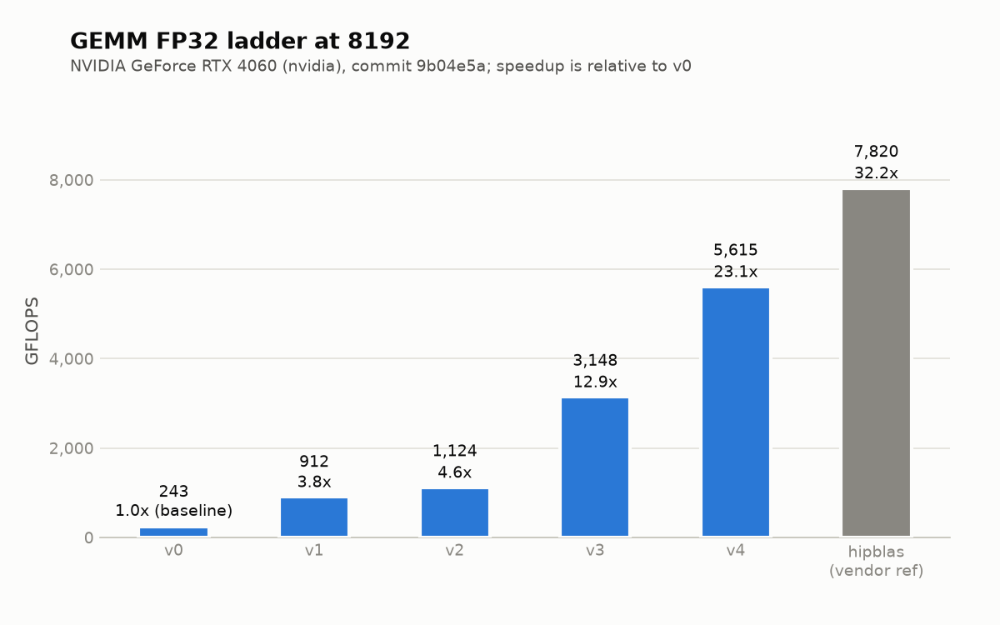

# Optimizing GEMM on AMD MI300X: from {{v0}} to {{v5}} TFLOPS, then running GPT-2 on it

> DRAFT. Every `{{placeholder}}` is a number, figure or claim to fill in after benchmarking. Delete any sentence whose prediction the profiler contradicted, or rewrite it with what you actually saw. Target length 1500 to 2000 words once filled in. Code: `{{repo_url}}`. Live performance chart: `{{pages_url}}`.

I wanted to know what it takes to make a GPU do matrix multiplication quickly, so I built the whole ladder by hand in HIP, measured every rung on an AMD Instinct MI300X (`{{device_name}}`, ROCm `{{rocm_version}}`), and then used the result to run GPT-2 end to end with no PyTorch at inference time. The code started on an RTX 4060 (HIP forwards to CUDA there) and the same source builds for both.

The one-paragraph summary: a naive kernel reaches `{{v0_fp32_4096_gflops}}` GFLOPS at 4096 x 4096; the best hand-written FP32 kernel reaches `{{v4_fp32_4096_gflops}}`; a matrix-core FP16 kernel reaches `{{v5_fp16_4096_gflops}}`; the vendor library reaches `{{hipblas_fp32_4096_gflops}}` (FP32) and `{{hipblas_fp16_4096_gflops}}` (FP16). GPT-2 small generates `{{llm_hip_tok_per_s}}` tokens/s here, against `{{llm_torch_tok_per_s}}` for PyTorch.

## The problem and the yardstick

GEMM computes `C = A * B`. For N x N matrices that is `2 N^3` floating-point operations: about `{{flops_4096}}` for N = 4096. The GPU can do far more arithmetic per second than it can fetch numbers from memory, so the whole game is **how many times each number fetched from memory gets used before it is thrown away**. I will keep one picture in mind: threads are workers, global memory (HBM) is a warehouse across town, and LDS (the on-chip scratchpad) and registers are the parts bins beside the assembly line. Fast kernels are the ones that make few trips to the warehouse.

The yardstick is hipBLAS, the vendor library. Every number below is a median over several timed launches, checked first against a double-precision CPU reference on awkward shapes (1x1x1, primes, shapes that do not divide the tile size).

`{{figure: docs/img/ladder_fp32.png, generated by scripts/plot_results.py}}`

## v0: one thread per output

Each thread owns one element of C and loops over K, reading one A value and one B value from global memory per multiply-add. That is 8 bytes fetched for 2 FLOPs, with nothing kept on chip. I deliberately mapped `threadIdx.x` to rows (the "textbook" mapping), which makes neighbouring lanes read addresses a whole row apart. Result: `{{v0_fp32_4096_gflops}}` GFLOPS, `{{v0_pct_hipblas_4096}}` of hipBLAS. `{{owner: what the profiler showed: coalescing, L2 traffic}}`

## v1: coalescing

Same algorithm, same loop. I only changed which thread takes which element so that neighbouring lanes read neighbouring addresses (`threadIdx.x` walks columns, 32 x 8 blocks, a 128-byte line per wave row). A GPU serves a wave's loads as a few wide transactions if they are adjacent, and as many narrow ones if not. Result: `{{v1_fp32_4096_gflops}}` GFLOPS, `{{v1_speedup_4096}}`x over v0. I predicted `{{owner: predicted}}`. `{{owner: sectors-per-request before and after}}`

## v2: LDS tiling

A block of 32 x 32 threads loads a tile of A and a tile of B into LDS once and every thread computes from it, so each number fetched is reused 32 times and global traffic per FLOP falls from 4 bytes to 0.125. Zeros are written into LDS for out-of-range elements so the inner loop has no branches. Result: `{{v2_fp32_4096_gflops}}` GFLOPS (`{{v2_speedup_4096}}`x). The new cost is LDS bandwidth: two LDS reads per FMA. `{{owner: bank conflicts and LDS instruction share from the profiler}}`

## v3: register blocking

Each thread now computes a 4 x 4 sub-tile and keeps 16 accumulators in registers. Per step it reads 4 values of A and 4 of B from LDS and does 16 FMAs, so FLOPs per LDS read go from 1 to 4. The block tile grows to 64 x 64, so global traffic halves again to 1/16 byte per FLOP. Result: `{{v3_fp32_4096_gflops}}` GFLOPS (`{{v3_speedup_4096}}`x). What limits it now is waiting for the next slab to arrive. `{{owner: stall reasons}}`

## v4: vector loads and double buffering

Two fixes for latency and instruction count. Each thread loads a `float4` (16 bytes) instead of four floats, which is legal only when the address is 16-byte aligned and the vector does not run past the row, so the launcher checks the pointers and strides and picks one of four kernel variants. And the next slab is fetched into registers while the current one is being computed, then written to the other of two LDS buffers, so only one barrier separates slabs. Result: `{{v4_fp32_4096_gflops}}` GFLOPS (`{{v4_speedup_4096}}`x), `{{v4_pct_hipblas_4096}}` of hipBLAS FP32. `{{owner: what did double buffering actually buy; occupancy cost}}`

## v5: matrix cores

An MFMA instruction on Instinct (`v_mfma_f32_16x16x16_f16`) computes a 16 x 16 x 16 block product, 4096 multiply-adds, in one wave instruction. v5 keeps v4's FP16 data movement exactly (the same staging code, tested on CPU) and swaps only the inner product: 4 waves per block, each wave owning 2 x 2 tiles of 16 x 16 in FP32 accumulators. The hard part was the lane layout: which lane holds which element of the A, B and result fragments. `{{owner: the bug(s) you hit and how the Matrix Instruction Calculator resolved them}}`

Result: `{{v5_fp16_4096_gflops}}` GFLOPS in FP16, `{{v5_speedup_4096}}`x over the scalar FP16 kernel, and `{{v5_pct_hipblas_4096}}` of hipBLAS. It is well short of the hardware's matrix-core peak (`{{device_fp16_matrix_peak_tflops}}` TFLOPS). My explanation: a 64 x 64 block tile with 32-deep slabs gives only 32 FLOPs per global byte, and the B fragments come from LDS with strided 2-byte reads. `{{owner: confirm or refute with MFMA utilisation and LDS counters}}` The next steps would be a transposed B in LDS, larger tiles and deeper pipelining.

## Roofline view

`{{figure: roofline from rocprof-compute for v0, v2, v4, v5 (docs/img/roofline_*.png)}}`

On the roofline plot v0 and v1 sit `{{owner}}`; v2 to v4 climb toward the FP32 compute roof; v5 is measured against the matrix-core roof instead. `{{owner: one sentence on where each one sits relative to the ridge point}}`

## Performance CI

A benchmark nobody re-runs rots. A GitHub Actions workflow runs on every push to `main` on a self-hosted GPU runner: build with CMake, run the correctness tests, run `gemm_bench` at 1024, 2048 and 4096 and the GPT-2 benchmark, and write one JSON file per kernel. A small script compares each (kernel, size) against a committed baseline and **fails the build if any kernel gets more than `{{threshold_pct}}`% slower** (or if any result failed verification). Every run is also appended to a history file published to GitHub Pages, so the chart at `{{pages_url}}` shows GFLOPS per commit. `{{owner: a real example where the check caught something, or the noise level you measured and why you chose the threshold}}`

`{{figure: screenshot of the Pages chart}}`

## From kernels to a language model

GPT-2 small (124M parameters, 12 layers) is a good target: small enough to read in an afternoon, real enough to expose everything that matters. The engine is C++/HIP: a byte-level BPE tokenizer written from scratch (checked token for token against OpenAI's reference implementation), a safetensors loader, and kernels for embedding, layer norm, GELU, attention, and the LM head, plus a KV-cache.

The key design point is that generation has two phases with opposite characters.

- **Prefill** processes the whole prompt at once. Each weight is reused once per prompt token, so the linear layers are genuine matrix multiplies and the engine calls the GEMM ladder's best FP32 kernel (v4).
- **Decode** processes one token at a time. Each weight is used once: 2 FLOPs per 4-byte weight, 0.5 FLOP per byte, far below any GPU's ridge point. Tiling cannot help; what matters is streaming about 500 MB of weights per token at full bandwidth, so decode uses simple matrix-vector kernels with coalesced reads. On a device with `{{device_hbm_bandwidth_gbs}}` GB/s that sets a ceiling of about `{{decode_bandwidth_ceiling_tok_per_s}}` tokens/s.

Attention reads the KV-cache. I wrote it twice: a naive version in three launches through a global score buffer (always used for prefill), and a fused decode version with one block per head and the scores kept in LDS. Correctness was checked against a float64 numpy implementation on a tiny random model (max abs logit error under 1e-3, greedy tokens identical), and against PyTorch on real GPT-2 weights: max abs logit error `{{h3_max_abs_err}}`, greedy tokens identical for 32 steps: `{{h3_greedy_match}}`.

### Numbers

| | TTFT (ms) | Decode (tokens/s) |
|---|---|---|
| hip-gpt2 (fused attention) | `{{llm_hip_ttft_ms}}` | `{{llm_hip_tok_per_s}}` |
| hip-gpt2 (naive attention) | `{{llm_hip_naive_ttft_ms}}` | `{{llm_hip_naive_tok_per_s}}` |
| PyTorch on ROCm | `{{llm_torch_ttft_ms}}` | `{{llm_torch_tok_per_s}}` |

Decode reaches `{{llm_pct_bw_ceiling}}` of the bandwidth ceiling. I expected it to be far below, because the matrix-vector kernels launch too few blocks to occupy a large GPU (one thread per output column gives 12 to 48 blocks per layer) and the fused attention uses only 12 blocks. `{{owner: what the profiler showed: per-kernel share, achieved bandwidth, launch gaps}}` Compared with PyTorch we are `{{owner: faster/slower and why}}`.

## What I would do next

Split-K matrix-vector kernels and flash-decoding to raise decode occupancy; fusing layer norm and residual adds to cut launches; a transposed-B, larger-tile v5; FP16 or INT8 weights for the engine, which directly attacks the bandwidth-bound decode. `{{owner: pick the ones you actually did}}`

## What I learned

`{{owner: 3 to 5 honest sentences: what surprised you, what your prediction got wrong, one thing you would explain differently now}}`

Code, results and the profiler commands to reproduce everything: `{{repo_url}}`.
